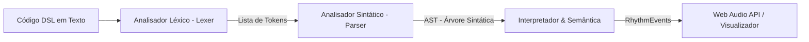

# Documentação da Implementação do Interpretador DSL - CodeStar

Este documento serve como guia prático e conceitual para **explicar**, **testar manualmente** e **documentar os resultados** da camada do Interpretador da DSL do projeto CodeStar.

---

## 1. Como Explicar a Implementação

Ao apresentar ou documentar a arquitetura do interpretador, explique a pipeline dividida em 3 fases principais:



### Explicação por Componente:

1. **Analisador Léxico (`Lexer`)**:
   * **Função**: Lê o código-fonte como uma sequência de caracteres e o transforma em uma lista de **Tokens** estruturados (ex: `KEYWORD_INSTRUMENT`, `NUMBER`, `INSTRUMENT_NAME`).
   * **Validação**: Verifica a regra de **caixa alta** (`PLAY`, `REPEAT`, etc.). Se o aluno digitar em minúsculas (ex: `play`), o Lexer gera uma mensagem educativa guiando a correção.

2. **Analisador Sintático (`Parser`)**:
   * **Função**: Pega os tokens do Lexer e constrói a **AST (Abstract Syntax Tree)** baseada na gramática da linguagem.
   * **Validação**: Garante a estrutura correta dos blocos (ex: obrigatoriedade do argumento em `INSTRUMENT <nome>`, quantidade em `REPEAT <n>` e o fechamento do bloco com `END`).

3. **Interpretador & Validador Semântico (`Interpreter`)**:
   * **Função**: Percorre a AST e traduz o programa em uma sequência cronológica de eventos rítmicos (`RhythmEvent[]`).
   * **Validação**: Garante que o comando `PLAY` só seja executado se houver um instrumento selecionado previamente (`kick`, `snare` ou `hihat`).

---

## 2. Como Testar Manualmente

### Passo 1: Execução da Suíte de Testes no Terminal

Você pode rodar os testes automatizados a qualquer momento com o comando:

```bash
npx tsx src/dsl/__tests__/dsl.test.ts
```

### Passo 2: Testes Manuais via Código / REPL

Para testar trechos de código novos manualmente, você pode importar a função `compileCode` em qualquer arquivo ou script de teste:

```typescript
import { compileCode } from './src/dsl';

const codigoParaTestar = `
REPEAT 2
  INSTRUMENT kick
  PLAY
  WAIT
END
`;

const resultado = compileCode(codigoParaTestar);

console.log('--- ERROS ---');
console.log(resultado.errors);

console.log('--- EVENTOS RÍTMICOS ---');
console.table(resultado.events);
```

---

## 3. Matriz de Testes & Resultados Documentados

Abaixo está o modelo de tabela que você pode incluir na documentação acadêmica, relatório do projeto ou no Game Design Document (GDD):

| ID | Caso de Teste | Entrada DSL | Resultado Esperado | Status |
| :--- | :--- | :--- | :--- | :--- |
| **CT-01** | Ritmo Simples Sequencial | `INSTRUMENT kick`<br>`PLAY`<br>`WAIT`<br>`PLAY` | 3 eventos gerados (2 de som `kick`, 1 pausa) sem erros. | ✅ Aprovado |
| **CT-02** | Bloco de Repetição | `REPEAT 2`<br>`  INSTRUMENT snare`<br>`  PLAY`<br>`END` | 2 repetições completas ativadas (2 eventos `snare`). | ✅ Aprovado |
| **CT-03** | Erro de Caixa Baixa | `play` | Retorna erro na linha com sugestão: *"Use 'PLAY' em vez de 'play'"*. | ✅ Aprovado |
| **CT-04** | `PLAY` Sem Instrumento | `PLAY` | Retorna erro semântico: *"PLAY exige que um instrumento seja selecionado previamente"*. | ✅ Aprovado |
| **CT-05** | `REPEAT` Sem `END` | `REPEAT 2`<br>`PLAY` | Retorna erro sintático: *"Bloco 'REPEAT' iniciado na linha X não foi encerrado com 'END'"*. | ✅ Aprovado |

---

## 4. Exemplo de Log de Saída do Interpretador

Ao compilar um ritmo válido:

**Entrada:**
```text
INSTRUMENT kick
PLAY
WAIT
PLAY
```

**Saída JSON (`RhythmEvent[]`):**
```json
[
  { "stepIndex": 0, "type": "play", "instrument": "kick", "line": 3 },
  { "stepIndex": 1, "type": "wait", "line": 4 },
  { "stepIndex": 2, "type": "play", "instrument": "kick", "line": 5 }
]
```

Esta estrutura fica pronta para ser enviada diretamente para o sequenciador da **Web Audio API** e para destacar visualmente a trilha durante a execução.
